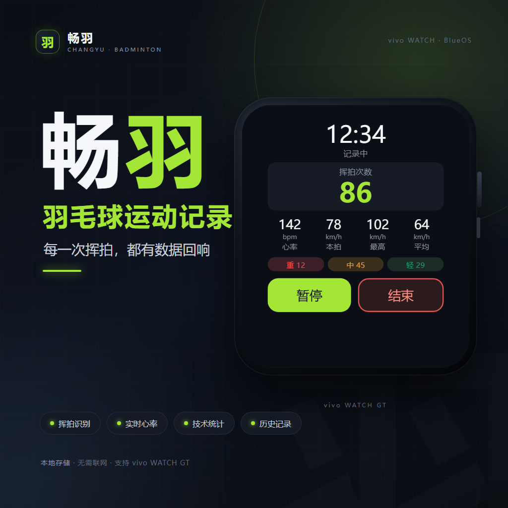
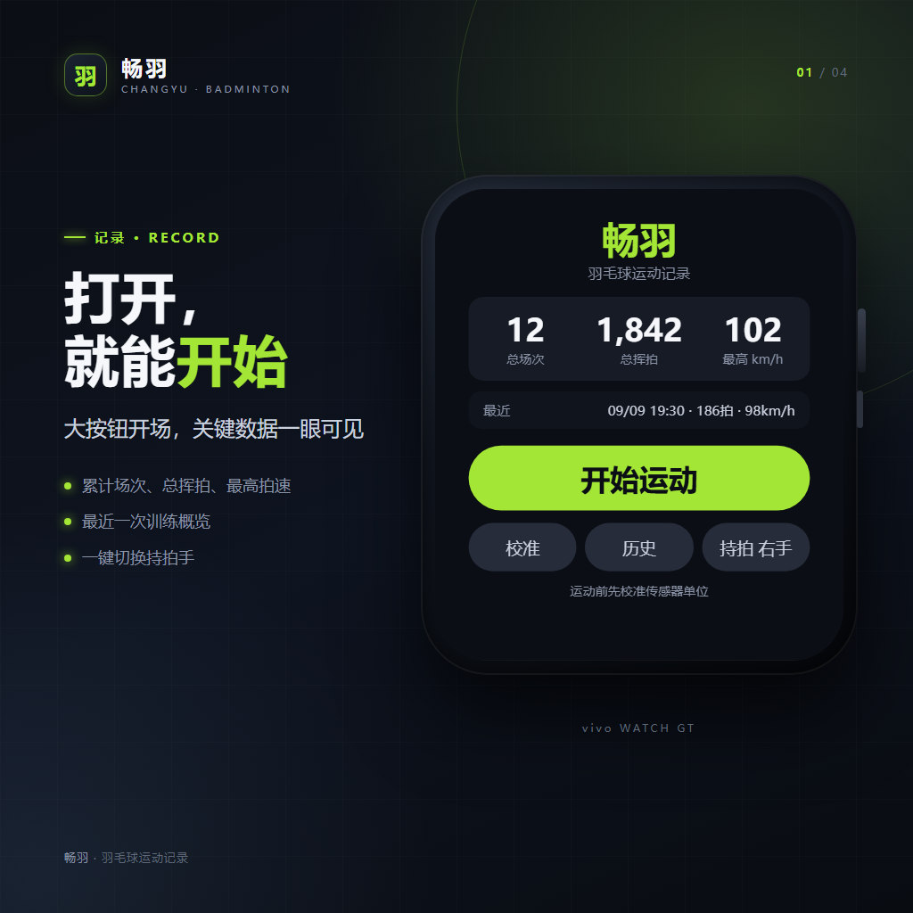
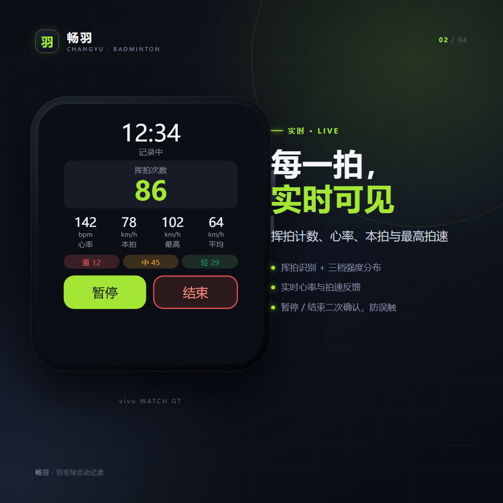
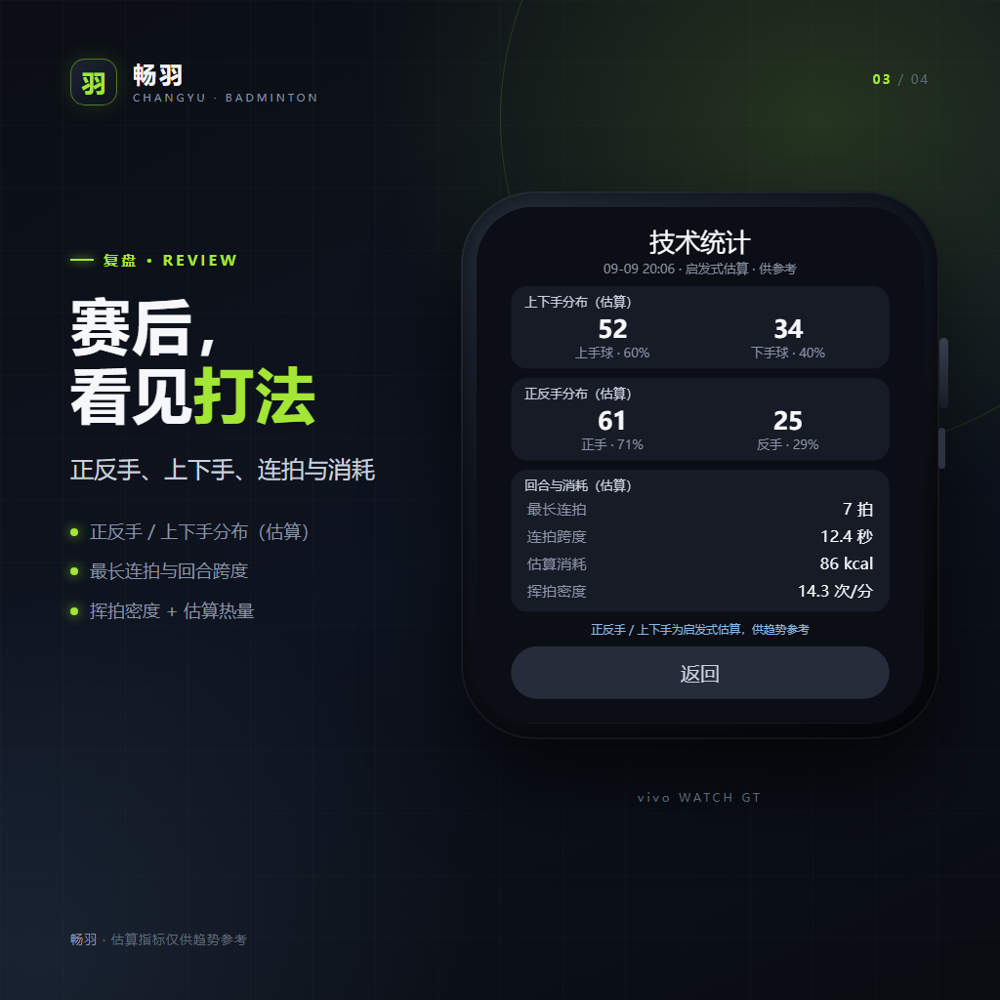
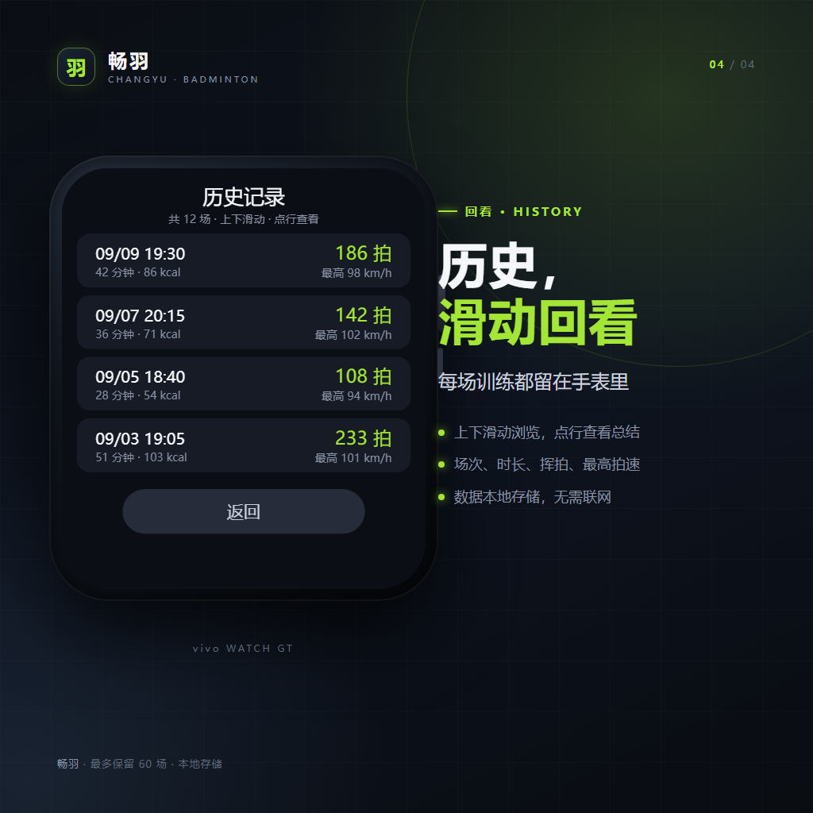

# 畅羽 · vivo WATCH 羽毛球运动记录

> 本仓库仅用于应用展示与安装包分发，**不包含源码**。

[在线作品集](https://nanxiao2020.github.io/changyu-app/) · [下载最新版本](https://github.com/Nanxiao2020/changyu-app-app/releases/latest)

## 应用简介

畅羽是一款运行在 vivo WATCH GT（390×450，BlueOS 3.0+）上的羽毛球运动记录应用。它利用手表内置的加速度计与陀螺仪识别挥拍，在运动过程中实时显示挥拍数、心率与拍速；结束后生成运动总结与技术统计，并把场次保存在手表本地。

无需手机 App、无需账号、无需联网。

## 下载与安装

1. 打开 [Releases](https://github.com/Nanxiao2020/changyu-app-app/releases/latest)
2. 下载最新的 `.rpk` 安装包（当前为 `com.changyu.badminton.release.0.1.4.rpk`）
3. 手机安装 OrbitV / 蓝河助手，并与手表完成蓝牙配对
4. 在 OrbitV 中选择「导入本地 RPK」并安装
5. 手表上打开「畅羽」，首次使用先进入「校准」完成传感器单位校准

> 适用设备：vivo WATCH GT（390×450，BlueOS 3.0+）。GT2 尚未完成实机验证。

## 功能

- **挥拍识别**：IMU 峰值 + FWHM 过滤日常动作，实时计数
- **强度分级**：轻 / 中 / 重三档，对应吊球、高远、杀球等强度
- **实时数据**：心率、本拍、最高 / 平均拍速
- **运动总结**：时长、挥拍数、杀球 / 高远 / 吊球占比、心率
- **技术统计**：正反手、上下手分布（估算）、最长连拍、估算热量
- **历史记录**：上下滑动浏览，点行查看对应总结，本地最多 60 场
- **本地优先**：无网络权限、无账号、无广告、数据仅存手表

## 截图

| 首页 | 录制 | 技术统计 | 历史 |
|---|---|---|---|
|  |  |  |  |

更多素材：[`docs/assets/`](docs/assets/)

## 隐私说明

- 心率数据仅用于本场运动展示与统计
- 原始传感器波形不落盘，仅保存挥拍特征与场次汇总
- 不收集账号、位置、通讯录等信息
- 不含网络权限、不上传任何运动数据
- 历史记录最多保留 60 场，仅保存在手表本地
- 卸载应用会删除本地数据

## 免责声明

- 正反手、上下手、拍速与热量均为腕部传感器估算，仅供趋势参考，不构成专业训练或医疗建议
- 本应用不是医疗器械，与 vivo 官方无隶属关系
- 不包含「好球」或其他第三方商标、图标或素材

## 版本

当前版本：`0.1.4 / versionCode 5`

更新日志：

- **v0.1.4**：高清图标；移除录制页诊断信息；「探测」更名为「校准」；完成 release 构建
- **v0.1.3**：历史滑动浏览、技术统计页、总结页技术统计入口
- **v0.1.2**：历史记录、总结信息增强、录制按钮重设计

## 反馈

源码仓库为私有。如需合作、反馈问题或申请测试，请通过本仓库的 Issues 联系。